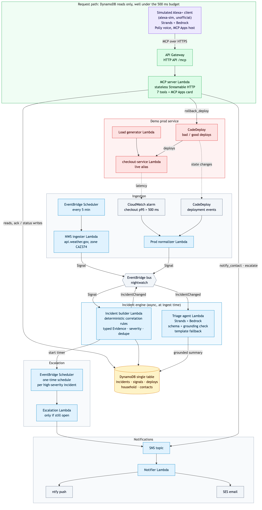

# Night Watch

[](https://github.com/Rohithvarma8/nightwatch/actions/workflows/slo.yml)
[](LICENSE)

**One incident engine for home emergencies and production on-call.** It's 3 AM and your phone buzzes. Is
it the pager, or the wildfire warning for your county? Night Watch is an Alexa+ add-on, built as an MCP
server on AWS. It pulls real National Weather Service alerts for your home and real CloudWatch alarms and
CodeDeploy deploys for your service, correlates them with deterministic rules, and answers "what's going
on?" in one or two spoken sentences. It covers what happened, how it knows, and what to do next. Then you
can act by voice: acknowledge, tell your roommate, escalate, or roll back the bad deploy.

> **Shown in a simulated Alexa+ client.** The Alexa+ add-on developer tools are partner-preview only. The
> organizers confirmed on the Devpost forum (topic 45262) that they aren't available to hackathon
> participants, so the demo uses [`alexa-sim/`](alexa-sim/), a local, clearly labeled, unofficial client:
> a Strands agent on Bedrock with Polly for the voice and a minimal MCP Apps host. The MCP server it talks
> to is the real one on AWS, and all the data is real: live NWS alerts, a real CloudWatch alarm from a real
> bad deploy, and real push and email notifications. Nothing is mocked. The add-on manifest is drafted in
> [`addon/`](addon/), ready for `alexa-ai deploy` when onboarding opens.

## What it does

Seven MCP tools. Every tool returns short spoken text plus `structuredContent`. Three of them also render
an MCP Apps incident card.

| Tool | Ask it | What it does |
|---|---|---|
| `get_active_incidents` 🃏 | "What's going on?" | Ranked spoken overview of open incidents, home and prod |
| `explain_incident` 🃏 | "Why do you think it's the deploy?" | Typed evidence, confidence, and timeline. Understands "the fire one" |
| `get_runbook` 🃏 | "What should I do about the wind?" | The runbook's next step, with the why |
| `acknowledge` | "I've got it." | Marks it acknowledged, so the escalation timer stands down |
| `notify_contact` | "Tell my roommate." | Push + email to a named contact (rate-limited, 3 per hour) |
| `escalate` | "Escalate it." | Marks it escalated and notifies the first contact in the escalation policy now |
| `rollback_deploy` | "Roll it back." | CodeDeploy rollback of the deploy linked to the alarm. Needs explicit confirmation |

🃏 = MCP Apps card (`ui://nightwatch/incidents.html`)

<!-- TODO before submission: add the simulator screenshot.

-->

## Architecture

[](docs/architecture.md)

Full diagram (Mermaid) and a walkthrough of each path: [docs/architecture.md](docs/architecture.md). The
MCP entry point is [`server/src/nightwatch/app.py`](server/src/nightwatch/app.py).

## Why it's different

- **Deterministic correlation with typed evidence.** [`triage/rules.py`](pipeline/src/nightwatch_pipeline/triage/rules.py)
  decides what goes together, and it emits typed `Evidence` records. A Red Flag Warning plus an
  overlapping Wind Advisory in the same zone becomes one Fire risk incident. A latency alarm shortly after
  a deploy becomes a deploy regression with rollback pinned as the first action. No cross-domain causal
  claims: weather never "causes" latency.
- **The LLM only narrates, and it's grounding-checked.** The Strands + Bedrock triage agent (Claude Haiku
  4.5, with Nova Lite as fallback) writes the summary from the evidence. Output must pass a JSON schema,
  and every number and place name has to appear in the source alerts. If not, the incident keeps a
  deterministic template and records `fallback_used=true`.
- **Reasoning at ingest time, so tool calls are DynamoDB reads.** Correlation, triage, and ranking all
  happen when a signal arrives. No tool handler calls an LLM or a third-party API. A read tool is a
  single DynamoDB query, and handlers take 2–23 ms of Lambda time.
- **Real alarms from a real bad deploy.** `checkout-service` is a real Lambda deployed with CodeDeploy.
  The bad version adds about 900 ms to about 30% of requests. The p95 alarm fires about 2.5 minutes after
  the deploy, and the incident exists within a second of ALARM. Saying "roll it back" started a real
  CodeDeploy rollback, and the alarm returned to OK 2 min 19 s later.
- **Replay honesty.** When there's no live hazard, `make replay` feeds archived real NWS alerts through
  the same pipeline, time-shifted. Replays carry `replay=true` and the original time, the card shows a
  replay footer, and the spoken answer says "replayed".

## Built to the Alexa+ MCP spec

Requirements are from Amazon's
[Alexa+ MCP Quickstart](https://developer.amazon.com/docs/alexaplus/add-ons/mcp-toolkit-quickstart.html).

| Requirement | Night Watch |
|---|---|
| Streamable HTTP | Stateless Streamable HTTP with JSON responses (MCP Python SDK v2 on Lambda + Lambda Web Adapter) |
| Protocol versions | Accepts `2025-03-26` (which the Alexa+ client has been documented sending) and `2025-11-25`, and returns the version requested. `2025-06-18` is accepted too, and `2026-07-28` negotiates down to `2025-11-25` |
| MCP Apps card | `_meta.ui.resourceUri` → `ui://nightwatch/incidents.html` (`text/html;profile=mcp-app`) on 3 tools. One self-contained file with no network calls |
| GET `/mcp` | `405` with `Allow: POST`. The SDK held GET open as an SSE stream, so a small wrapper rejects it ([FL-003](docs/friction-log.md)) |
| No `WWW-Authenticate` | No response carries it. Auth isn't implemented (the OAuth spike didn't ship), so the demo server is open; per Amazon's account-linking docs, account linking is optional for MCP add-ons |
| Round trip < 500 ms (warm) | **p95 89 ms** from a GitHub runner (mcp-slo in CI: 2 workers, 10 req/s, 0% errors). **p95 137 ms** from a laptop in an mcp-slo run (15 req/s, 456 requests). Single calls with curl: 0.14–0.25 s |
| Cold starts | **1.8–2.1 s** round trip on a cold Lambda (Init 1.1–1.5 s, about 0.9 s of it importing the MCP SDK, [FL-006](docs/friction-log.md)). Warmed by hand before recording. `make warm-on` sets provisioned concurrency = 1 if always-warm is needed |

The SLO is checked on every push to `main` by [mcp-slo](https://github.com/Rohithvarma8/mcp-slo)
([workflow](.github/workflows/slo.yml)) with `--profile alexa`: p95 < 500 ms, errors < 1%, the protocol
negotiation matrix, and a GET that doesn't hang.

## AWS services

| Service | How Night Watch uses it |
|---|---|
| AWS Lambda | MCP server (arm64, Lambda Web Adapter + uvicorn), NWS ingester, prod normalizer, incident builder, triage agent, escalation, notifier, and the demo checkout service + load generator |
| Amazon API Gateway (HTTP API) | Public `/mcp` endpoint, plus the demo service's endpoint |
| Amazon DynamoDB | Single table: incidents, signals (dedupe), deploy records, household, contacts. A sparse GSI serves "active incidents" |
| Amazon EventBridge | `nightwatch` bus carrying `Signal` and `IncidentChanged` events. Rules route CloudWatch alarm and CodeDeploy events |
| EventBridge Scheduler | NWS polling every 5 minutes, the load generator, and one-time escalation timers per incident |
| Amazon Bedrock | Triage agent summaries (Claude Haiku 4.5, Nova Lite fallback) and the simulated client's agent |
| Amazon Polly | Spoken replies in the simulated client (neural voice) |
| Amazon SNS / Amazon SES | Notification fan-out, and email to contacts (push goes through ntfy) |
| AWS CodeDeploy | Real bad and good deploys of `checkout-service`, and `rollback_deploy` |
| Amazon CloudWatch | The p95 latency alarm that opens prod incidents, plus logs |
| AWS Systems Manager Parameter Store | ntfy topic |
| Amazon S3 | Terraform state |

Everything is Terraform ([`infra/`](infra/)).

## How to try it

**a) MCP Inspector against the live server (no AWS account needed)**

```sh
npx @modelcontextprotocol/inspector
# Transport: Streamable HTTP · URL: https://2wj4gc9lz8.execute-api.us-west-2.amazonaws.com/mcp
```

or from the command line:

```sh
npx @modelcontextprotocol/inspector --cli https://2wj4gc9lz8.execute-api.us-west-2.amazonaws.com/mcp \
  --transport http --method tools/call --tool-name get_active_incidents
```

Please stick to the read tools (`get_active_incidents`, `explain_incident`, `get_runbook`). The write
tools have real side effects: they notify the demo contact, and `rollback_deploy` starts a CodeDeploy
deployment.

**b) The simulated Alexa+ client, locally**

Needs `uv` and AWS credentials with Bedrock `InvokeModel` (Claude Haiku 4.5 and/or Nova Lite) and Polly
`SynthesizeSpeech` in us-west-2.

```sh
make sim       # with access to this repo's Terraform state: http://localhost:8765 (Chrome; allow the mic)

# without it, point the simulator at the live URL directly:
cd alexa-sim && uv sync
MCP_URL=https://2wj4gc9lz8.execute-api.us-west-2.amazonaws.com/mcp AWS_REGION=us-west-2 \
  uv run uvicorn nightwatch_sim.app:app --host 127.0.0.1 --port 8765
```

`make sim-smoke` runs the demo turns. Its "yes" turns really notify and really roll back.

**c) Deploy your own**

Prerequisites: an AWS account (us-west-2), Terraform ≥ 1.10, `uv` and Python 3.12, Bedrock model access
for Claude Haiku 4.5 and/or Nova Lite, an SES-verified sender address, and an
[ntfy](https://ntfy.sh) topic.

```sh
terraform -chdir=infra/bootstrap apply            # S3 state bucket; set it in infra/envs/dev/versions.tf
cp infra/envs/dev/terraform.tfvars.example infra/envs/dev/terraform.tfvars   # fill in
make setup
make deploy                                       # build Lambda zips + terraform apply; prints the MCP URL
make seed-household                               # demo household, contact, escalation policy
make replay FILE=…                                # or wait for a real NWS alert
```

Development: `make lint test`. Demo helpers: `make demo-reset`, `make demo-prod`, `make bad-deploy` /
`make good-deploy`.

## Links

- [Friction log](docs/friction-log.md): 12 entries on Alexa+, the MCP SDK, Bedrock, and AWS, each with
  its workaround
- [Devlog](docs/devlog.md): what was built each day, with measured numbers
- [Backlog](docs/backlog.md)
- [Architecture](docs/architecture.md) · [Design reference](DESIGN.md)
- [mcp-slo](https://github.com/Rohithvarma8/mcp-slo): the open-source MCP reliability tester built for
  this project (MIT)
- [LICENSE](LICENSE) (Apache-2.0)
