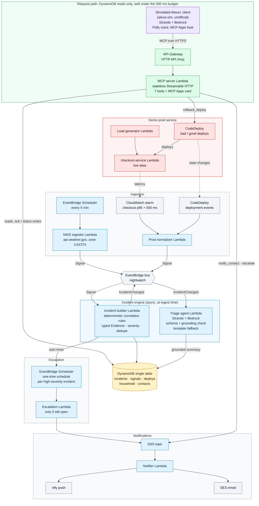

# Architecture

Night Watch is one incident engine with two sources: home hazards (NWS alerts) and production on-call
(a CloudWatch alarm and CodeDeploy deploys from a demo service). Everything slow happens at ingest time.
When a client asks a question, the MCP server only reads DynamoDB.




## The paths

**Request path (green).** The simulated Alexa+ client calls the MCP server through API Gateway. Tool
handlers talk only to DynamoDB, plus SNS for `notify_contact` and `escalate` and CodeDeploy for
`rollback_deploy`. Summaries, evidence, and actions were all computed at ingest time, so a read tool is a
single DynamoDB query. There's no LLM, no third-party HTTP, and no per-request config lookup. Transport is
stateless Streamable HTTP with JSON responses. GET `/mcp` returns 405, and no response carries a
`WWW-Authenticate` header.

**Ingestion.** The NWS ingester runs every 5 minutes on EventBridge Scheduler and turns new alerts for the
household's zone into `Signal` events. The prod normalizer receives the checkout-service CloudWatch alarm
state changes and CodeDeploy deployment events through EventBridge rules, and emits the same `Signal`
shape. Replayed alerts (`make replay`) take the same path, flagged `replay=true` with the original time.

**Incident engine.** The incident builder dedupes signals, groups them into incidents by correlation key,
and runs the deterministic rules in `triage/rules.py`. For example, a Red Flag Warning plus an overlapping
Wind Advisory merge into one Fire risk incident, and an alarm shortly after a deploy becomes a deploy
regression with rollback pinned as the first action. Each rule emits typed `Evidence`. The triage agent
(Strands on Bedrock) then narrates that evidence. Its output must pass a JSON schema and a grounding check:
every number and place name has to appear in the source signals. If it fails, the incident keeps the
deterministic template and records `fallback_used=true`.

**Escalation.** For a new high-severity incident, the builder creates a one-time EventBridge Scheduler
schedule set to the household's acknowledgement timeout. When it fires, the escalation Lambda escalates
only if the incident is still open, so after `acknowledge` the timer is a no-op.

**Notifications.** `notify_contact`, `escalate`, and the escalation Lambda publish to SNS. The notifier
sends an ntfy push and an SES email. SMS is a stub.

**Demo prod service.** `checkout-service` is a real Lambda behind its own HTTP API, deployed with
CodeDeploy. The bad version sleeps about 900 ms on about 30% of requests. The load generator keeps
traffic flowing so the p95 alarm fires for real, about 2.5 minutes after a bad deploy.

## Regenerating the PNG

```sh
npx -y @mermaid-js/mermaid-cli -i docs/architecture.md -o docs/architecture.png -s 2 -b white
```

mermaid-cli writes one PNG per diagram, numbered like `architecture-1.png`. Rename it to
`architecture.png`.
